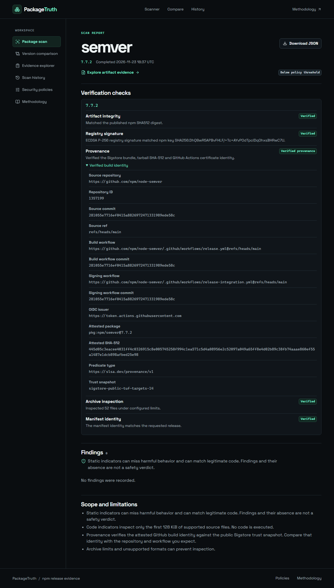
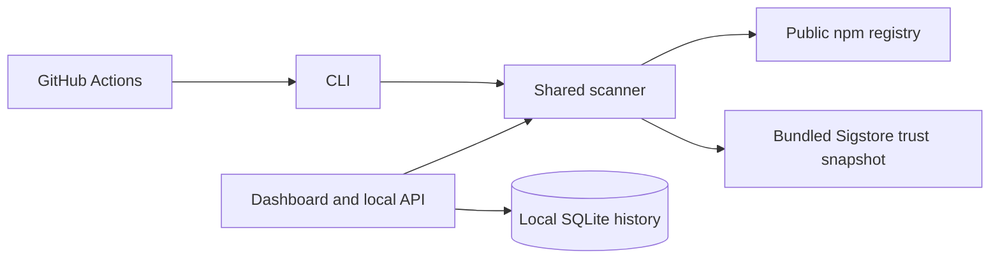

# PackageTruth

**Verify what an exact npm release contains, where it was built, and what changed.**

PackageTruth checks packages from the public npm registry before you install them. It verifies the
downloaded archive against published evidence, inspects its contents in memory, and produces a report
you can review in a local dashboard, script from the CLI, or use in GitHub Actions.

[Quick start](#quick-start) · [Verified provenance example](#verified-provenance-example) ·
[How it works](#how-it-works) · [GitHub Actions](#github-actions) · [Security](#security-and-limitations)


## Why it matters

A dependency update can change what gets installed, including install scripts and executable files.
A lockfile records selected versions and checksums, while a release note describes changes the maintainer
chose to document. When reviewing an update, you may need to see exactly which files changed or check
whether the published archive matches the project's expected build workflow.

For example, comparing `is-number` 6.0.0 and 7.0.0 in a live run found **four modified files**. The
comparison gives you the file-level evidence and related manifest changes to review before approving the update.

### Working alongside GPT and Codex

Use PackageTruth to collect checksums, signature results, provenance claims, and file differences from
the published bytes. Give GPT or Codex the relevant JSON to explain a finding, summarize a diff, or help
draft a pull-request review. A useful prompt is “Summarize the file and dependency changes, and list
which conclusions are supported by the report.” PackageTruth runs independently of either tool.

## Quick start

Use Node.js **24.15+ on the 24.x line**, or **26+**, with npm. Run these commands from the repository root
using PowerShell, Command Prompt, Bash, or zsh. Use `npm.cmd` if PowerShell blocks the npm script shim.

```sh
npm ci --ignore-scripts
npm run build:core
npm exec -- packagetruth --help
npm exec -- packagetruth scan "semver@7.7.2" --json
npm exec -- packagetruth compare is-number 6.0.0 7.0.0 --json
```

Run `scan` or `compare` without `--json` for a human-readable report. The CLI also runs directly as
`node packages/cli/dist/index.js`. JSON reports go to stdout, and errors go to stderr. The default
severity threshold is `critical`. Use `--fail-on off` to disable severity-based exits.

| Exit code | Meaning |
| --- | --- |
| 0 | Completed under the configured policy |
| 1 | Operational error or incomplete lockfile coverage |
| 2 | Invalid arguments or scan input |
| 3 | A finding met the configured severity threshold |

### Local dashboard

```sh
npm run dev
```

Open [http://127.0.0.1:3000](http://127.0.0.1:3000). Choose **Package scan**, enter **semver** and **7.7.2**,
and expand **Verified build identity**. For a local production build, run `npm run build` followed by
`npm start`.

History uses `.data/packagetruth.sqlite` and retains up to 40 reports within a 64 MiB serialized report budget.
Set `PACKAGETRUTH_DB` in your shell or in `apps/web/.env.local` to use an absolute path. See
[.env.example](.env.example) for the configuration template.

## Verified provenance example

Provenance is a signed statement about how an artifact was built. In a live scan of `semver@7.7.2`,
PackageTruth verified the published SHA-512 checksum, the npm registry's ECDSA P-256 signature, and the
Sigstore attestation. It inspected 52 files and reported the following build identity.

| Evidence | Verified value |
| --- | --- |
| Attested package | `pkg:npm/semver@7.7.2` |
| Source repository | [npm/node-semver](https://github.com/npm/node-semver) |
| Source commit | `281055e7716ef0415a8826972471331989ede58c` |
| Source ref | `refs/heads/main` |
| Calling workflow | `.github/workflows/release.yml` |
| Signing workflow | `.github/workflows/release-integration.yml` |
| Attested SHA-512 | `445d05c3eacee4031ff4c0326915c8e005745258f994c1ea571c5d4a08956e2c52097a049a65ff8e4d02b89c38fb74aaae860ef55a1487e1dcb898afbed25e98` |

<details>
<summary>View the production dashboard's verified provenance report</summary>



</details>

Both screenshots were captured during the production browser suite. See
[provenance verification and trust maintenance](docs/provenance.md) for the supported attestation profile.

## Implemented features

| Area | What you can do |
| --- | --- |
| Release scan | Verify artifact integrity, supported npm ECDSA signatures, and supported Sigstore provenance. View separate check statuses and signed source evidence. |
| Archive review | Inspect file paths, sizes, hashes, executable indicators, and selected manifest data. Review static findings with rule IDs, severity, evidence, and suggested actions. |
| Version comparison | Compare added, removed, and modified files, install hooks, executable changes, dependencies, and selected manifest fields. |
| CLI and dashboard | Run scans and comparisons, filter findings or file paths in the dashboard, reopen local history, and export JSON evidence. The local API uses the same scanner. |
| Policy | Check changed resolutions in npm v2 and v3 lockfiles. Apply a severity threshold in the CLI or GitHub Actions, and highlight results against a separate local dashboard policy. |

## How it works

1. **Resolve an exact release.** Fetch public npm metadata for the requested package and version, then
   download that release's archive under strict destination, size, and timeout limits.
2. **Verify the bytes.** Match the published digest before archive inspection. Check a supported npm
   registry signature and, when advertised, verify supported Sigstore provenance against the same bytes
   and the signed build identity.
3. **Inspect the archive in memory.** Stream the archive under file and decompression limits, hash its
   files, and record manifest details and static indicators without installing or running the package.
4. **Report or compare.** Return structured evidence. For a comparison, check both versions and diff
   their inventories and selected manifest fields. For lockfiles, check changed resolutions and apply
   the configured policy.

### Architecture



### Technology stack

The npm workspace uses TypeScript and Node.js. The dashboard uses Next.js App Router, React,
Tailwind CSS, and Node's built-in SQLite driver. Sigstore JS handles provenance verification.
Development checks use Vitest, Playwright, ESLint, and GitHub Actions.
See the [architecture and local API reference](docs/architecture.md) for component boundaries and routes.

## GitHub Actions

The **Dependency evidence** workflow reviews pull requests that change the root `package-lock.json`.
It checks out the base commit, verifies a bounded lockfile blob from the proposed revision, and uploads
JSON evidence. It uses read-only repository permissions and installs base-revision tooling with
lifecycle scripts disabled.

Use repository variables `PACKAGETRUTH_FAIL_ON` and `PACKAGETRUTH_FAIL_ON_INCOMPLETE` to configure
the gate. The defaults are `critical` and `false`. The workflow includes manual `allow` and `block`
demonstrations using the same CLI. Run the fixture checks locally.

```sh
npm exec -- packagetruth lock-check fixtures/dependency-policy/base.lock.json fixtures/dependency-policy/allow.lock.json
npm exec -- packagetruth lock-check fixtures/dependency-policy/base.lock.json fixtures/dependency-policy/block.lock.json
```

Both fixtures scan the same public artifact. The allow case exits **0**. The block case exits **3**
with `PT-LOCK-001` because the synthetic lockfile checksum differs from the verified artifact.
Hosted GitHub Actions execution remains unverified. See the [fixture notes](fixtures/dependency-policy/README.md)
and the [hosted validation runbook](docs/github-actions.md).

## Verified testing

The v0.1.0 release candidate passed installation, type checking, lint, and the production build on
Windows. The release verification recorded **108 Vitest tests** on both Node.js 24.15.0 and 26.13.0,
including three live npm provenance cases, and **5 Playwright tests** against the production build.
Both workflow definitions and the allow/block policy cases were checked locally. Native Linux and macOS
installations remain unverified. See the [release-readiness report](docs/release-readiness.md).

```sh
npm run typecheck
npm run lint
npm test
npm run build
npm exec -- playwright install chromium
npm run test:e2e
```

The default Vitest suite uses local fixtures. Browser tests require public npm access. On supported
Linux runners, use `npm exec -- playwright install --with-deps chromium` for system dependencies.
See [Contributing](CONTRIBUTING.md) for live checks and screenshot capture commands.

## Security and limitations

- **Scope.** The scanner targets exact public npm releases. Unsupported archive formats and resource
  limits can leave some evidence incomplete. Linked, bundled, and non-public lockfile resolutions are
  outside independent registry artifact verification.
- **Interpretation.** A matching checksum confirms the downloaded bytes match the registry's published
  digest. Compare the authenticated provenance identity with the source you expect. Static findings
  can miss behavior or flag legitimate code. These checks cannot establish package safety.
- **Trust maintenance.** Supported attestations reaching the trust check on or after
  **2027-02-21 00:00 UTC** report incomplete provenance verification until the bundled snapshot is
  refreshed. Other checks retain their separate results.
- **Local access.** The dashboard is intended for loopback use and has no authentication.

See the [threat model](docs/threat-model.md), [detection rules](docs/detection-rules.md),
[security audit](docs/security-audit.md), and [security reporting policy](SECURITY.md).

## Roadmap

- Add configurable expected-source policies and support more attestation profiles.
- Expand archive compatibility with bounded PAX extended-header support.
- Compare old and new release artifacts for each changed dependency in lockfile review.

[Changelog](CHANGELOG.md) · [Contributing](CONTRIBUTING.md) · [MIT license](LICENSE)
