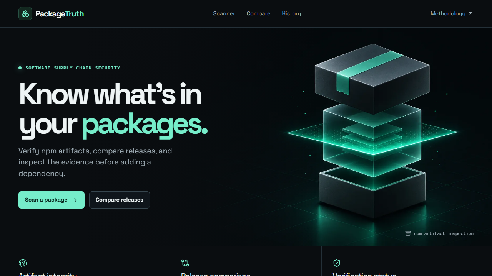

# PackageTruth

PackageTruth collects reviewable evidence about an exact npm release. It checks downloaded bytes against the published digest, verifies supported npm registry signatures, inspects the archive without executing it, and compares what two releases ship. Static findings and verified checks do not establish whether a package is safe.

## Features

- **Scanner** for public, exact npm releases, with archive inventory, manifest metadata, digests, verification states and static review findings.
- **Release comparison** for added, removed and modified files, lifecycle hooks, executables, dependencies and selected manifest fields.
- **CLI** with human-readable and JSON reports, severity thresholds and lockfile checks.
- **Local dashboard** with scanning, comparisons, verification details, evidence filtering, JSON export, SQLite history, policy settings and methodology.
- **GitHub Actions** for read-only review of changed public npm resolutions in `package-lock.json` and repository verification.

TypeScript and Node.js power the scanner and CLI. The dashboard uses Next.js App Router, React, Tailwind CSS and Node’s built-in SQLite driver. npm workspaces share the scanner and evidence model across all entry points.

## Installation and CLI

Use Node.js 24 or newer and npm. From the repository root:

```sh
npm ci --ignore-scripts
npm run build:core
npm exec -- packagetruth --help
npm exec -- packagetruth scan lodash@4.17.21
npm exec -- packagetruth scan @types/node@24.0.0 --json
npm exec -- packagetruth compare is-number 6.0.0 7.0.0 --json
npm exec -- packagetruth lock-check base-lock.json head-lock.json --fail-on high
```

The CLI also runs with `node packages/cli/dist/index.js`. Exit codes are **0** completed under the policy, **1** operational error or incomplete lockfile coverage, **2** invalid CLI or scan input, and **3** policy threshold reached. The default finding threshold is critical. Set `--fail-on off` to turn off severity-based exits. JSON reports go to stdout, and errors go to stderr.

## Dashboard

```sh
npm run dev
```

Open [the local dashboard](http://127.0.0.1:3000). To run the production build locally:

```sh
npm run build
npm start
```

The database defaults to `.data/packagetruth.sqlite`. Set `PACKAGETRUTH_DB` to an absolute path through the environment or an app-local Next.js env file. See [.env.example](.env.example). The dashboard uses the local policy to highlight evidence and stores up to 40 reports within a 64 MiB serialized report budget.



[View the live npm scan report screenshot](docs/screenshots/scan-report.png).

## GitHub dependency evidence

The dependency workflow runs on pull requests that change the root `package-lock.json`. Its checked-out code and tooling dependencies come from the base commit. It requests the head commit and root tree through GitHub’s public API, checks the lockfile blob’s mode, length and Git digest, then treats its contents as JSON input. It uses read-only repository permission, persists no checkout credentials, and executes no code from the proposed lockfile. The job summary lists coverage and links through the workflow run to a JSON artifact with findings and review actions.

Set repository variable `PACKAGETRUTH_FAIL_ON` to a severity or `off`. The default is `critical`. Missing or unsupported coverage is reported separately and is nonblocking by default. Set `PACKAGETRUTH_FAIL_ON_INCOMPLETE=true` to reject partial coverage. The public API can rate-limit unauthenticated requests. The workflow’s proposed definition is reviewable in the pull request and should be covered by repository review controls when used as a required gate.

## Security model and limits

The scanner makes direct requests only to the public npm registry, refuses redirects, and enforces size and time limits. It hashes the compressed bytes before inspecting a bounded decompressed stream. It never extracts an archive to disk or installs an inspected package. A registry checksum mismatch, unavailable checksum, signature failure and static finding have distinct evidence. Older releases may use weak SHA-1 checksums or keys unavailable for current verification.

Provenance status reflects what exact-version npm metadata advertises. Sigstore bundle validation is unsupported. The tar parser accepts a constrained set of regular files and directories. Releases requiring extended headers or exceeding limits may yield partial evidence. Static rules use limited source samples and may miss harmful behavior or flag legitimate code. The dashboard is intended for loopback use on one machine and has no authentication.

See the [architecture](docs/architecture.md), [threat model](docs/threat-model.md), [rule catalog](docs/detection-rules.md), and [npm’s registry signature format](https://docs.npmjs.com/about-registry-signatures/).

## Verification

```sh
npm run typecheck
npm run lint
npm run test:unit
npm run test:integration
npm run build
npm exec -- playwright install chromium
npm run test:e2e
```

Vitest uses deterministic inert archives and local transport responses. Playwright exercises the production dashboard against live public npm releases and checks CLI and API evidence parity.

## Roadmap

1. Verify single-release Sigstore attestations with a maintained verifier and explicit source identity expectations.
2. Extend archive compatibility with bounded PAX handling and additional compatibility fixtures.
3. Add a lockfile review mode that compares previous and proposed release artifacts for each changed dependency.

MIT licensed. See [CONTRIBUTING.md](CONTRIBUTING.md) and [SECURITY.md](SECURITY.md).
