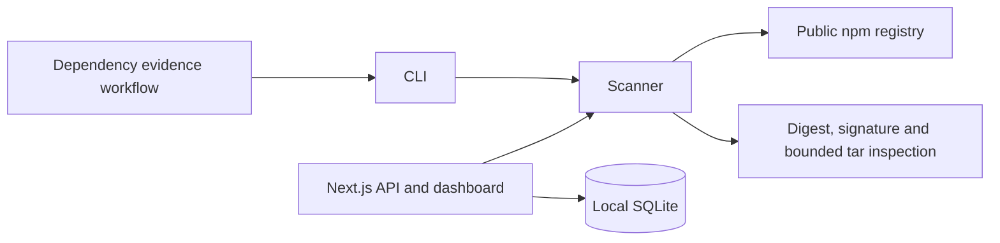

# Architecture

- `packages/shared` defines report version 1, finding types, severity order and threshold evaluation.
- `packages/scanner` validates identifiers, fetches metadata for one exact version and restricts tarball URLs to the matching public npm path. It collects compressed bytes under a hard cap, hashes them, and streams a verified artifact through the gzip and tar readers. Evidence includes compressed digests, per-file SHA-256, selected manifest fields and static findings.
- `packages/cli` formats reports, returns policy exit codes and checks changed npm lockfile resolutions. It verifies a lockfile digest against calculated artifact digests after registry checksum verification.
- `apps/web` reuses the scanner on Node.js. SQLite stores complete report JSON and policy settings. Reports are versioned, paginated in the views and downloadable as JSON. The local history holds up to 40 reports and 64 MiB of serialized report data. SQLite’s file allocation and WAL can differ from that logical budget.
- `fixtures` builds deterministic inert archives. Integration tests supply local metadata, tarballs and test signing keys through a transport seam. Production callers use the hard-coded npm registry.

## Local API

Send JSON to the loopback dashboard. Scan and comparison return HTTP 201 with `{id, report}`. Operational and input errors return an HTTP error with an `error` message and, where available, a scanner `code`.

| Method | Path | Body or response |
| --- | --- | --- |
| POST | `/api/scan` | `{"name":"lodash","version":"4.17.21"}` |
| POST | `/api/compare` | `{"name":"is-number","before":"6.0.0","after":"7.0.0"}` |
| GET | `/api/reports/{id}` | Report JSON attachment |
| PUT | `/api/policy` | `{"threshold":"medium"}` |

Browser requests must originate from the same loopback host. The API limits active scans and recent submissions in one server process.

## Landing artwork

The landing illustration was created with built-in ImageGen and packaged as [artifact-inspection.webp](../apps/web/public/artifact-inspection.webp).

> Wide 3:2 editorial 3D illustration for a premium software supply-chain security tool website, no text or letters or logos. A single exploded npm-like software parcel represented as three floating dark graphite and matte glass isometric cubes or slices, a thin brilliant electric mint-teal scan plane bisecting the center, subtle tiny data motes, faint blueprint perspective grid receding in the near-black backdrop. Compact sculptural object sits in the right half of the composition, generous deep charcoal negative space at the left edge and around it, seamless near-black #0a0d10 boundaries, realistic industrial product-render materials, crisp controlled studio rim light, high contrast, refined and quiet, no interface, no characters, no gradients of other hues. The accent is mint teal only.
